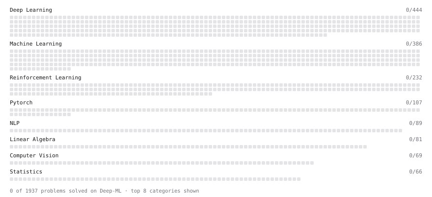

# Deep-ML

My machine learning practice from [Deep-ML](https://www.deep-ml.com). Every solution here was written by hand.

**8** solved · 0 problems · 0 labs · 8 math

[**Browse the interactive portfolio**](https://guheshk.github.io/deep-ml/) to replay this filling in over time.

## Math

| | Difficulty | Solved | |
| --- | --- | --- | --- |
| [Derivatives and Gradients](https://www.deep-ml.com/math-problems/1) | easy | 2026-11-06 | [solution](math/0001-derivatives-and-gradients) |
| [Gradient Descent Updates](https://www.deep-ml.com/math-problems/5) | easy | 2026-11-06 | [solution](math/0005-gradient-descent-updates) |
| [Condition Numbers: Why the Determinant Lies About Near-Singularity](https://www.deep-ml.com/math-problems/412) | medium | 2026-11-06 | [solution](math/0412-condition-numbers-why-the-determinant-lies-about-near-singularity) |
| [Orthogonality and Projections](https://www.deep-ml.com/math-problems/14) | medium | 2026-11-06 | [solution](math/0014-orthogonality-and-projections) |
| [Schur Complements and the Partitioned Inverse](https://www.deep-ml.com/math-problems/409) | medium | 2026-11-06 | [solution](math/0409-schur-complements-and-the-partitioned-inverse) |
| [Solving Linear Systems](https://www.deep-ml.com/math-problems/13) | medium | 2026-11-06 | [solution](math/0013-solving-linear-systems) |
| [Woodbury, Sherman-Morrison and the Matrix Determinant Lemma](https://www.deep-ml.com/math-problems/410) | medium | 2026-11-06 | [solution](math/0410-woodbury-sherman-morrison-and-the-matrix-determinant-lemma) |
| [Matrix Decompositions: LU and QR](https://www.deep-ml.com/math-problems/15) | hard | 2026-11-06 | [solution](math/0015-matrix-decompositions-lu-and-qr) |

---

_This file is regenerated by Deep-ML on every push._
